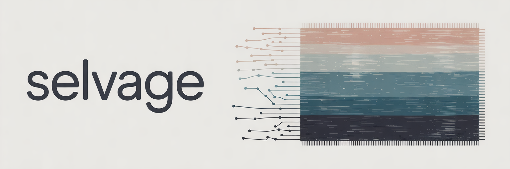
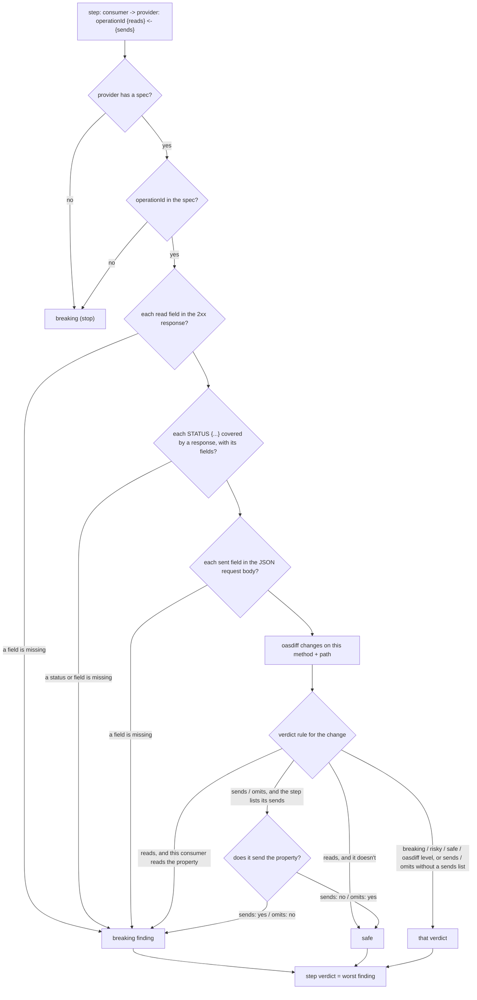

# selvage

A viewer for API contracts across services. It reads OpenAPI specs and plaintext flow files from a git repo and renders an endpoint reference, sequence diagrams and a compatibility report. A CI gate fails when a spec change breaks a documented flow.

## Why flows matter

oasdiff judges a spec change against "any client". A flow says which consumer calls which operation and which response fields it reads. With that information, selvage judges each change against each real consumer. Two examples:

- Removing an optional response field is `info` in oasdiff. It is breaking for a consumer that reads the field.
- Renaming an `operationId` is `info` in oasdiff. It is breaking for every flow (and every generated client) that uses the old id.

## Repo layout

```
specs/<service>.yaml     one OpenAPI 3.x file per service; "<service>.openapi.yaml" also works
specs/*.schema.json      JSON Schemas a spec $refs (relative paths, resolved at the same revision)
flows/<name>.flow        one flow per file
selvage.yaml             optional verdict rules (below)
```

Flow format:

```
# Checkout
// comments start with //
web -> orders: createOrder {id, status} 409 {error.code} <- {cartId, lines.sku}
orders -> payments: chargeCard {chargeId}
web -> orders: getOrder {status, total.amount}
```

Each step is `consumer -> provider: operationId {fields read from the 2xx JSON response} STATUS {fields read from that response} <- {fields sent in the JSON request body}`. Every list is optional; the sent list comes last. `409 {error.code}` says the consumer branches on that field of the 409 body; repeat it for other statuses. A status is a code, a range (`4XX`) or `default`. Field paths use dots. Arrays are traversed implicitly.

## API linting: how each step is checked

`check` and the compatibility report lint every flow step against the specs at the head revision (`checkStep` in `compat.go`). For each step `consumer -> provider: operationId {reads} <- {sends}`:



1. **The provider has a spec.** No spec for the service: breaking.
2. **The operation exists.** `operationId` is not in the provider's spec: breaking ("removed or renamed?"). A flow that documents a proposed operation shows as breaking until the operation lands in the spec.
3. **The fields the consumer reads exist.** Each field in `{...}` must be in the operation's 2xx response schema; dots walk nested objects and arrays are traversed implicitly. A missing field: breaking.
4. **The other responses the consumer handles exist.** For each `STATUS {...}`, a response must cover that status (its own entry, else its range such as `4XX`, else `default`), and each field must be in that response's body schema. An uncovered status or a missing field: breaking.
5. **The fields the consumer sends exist.** Each field in `<- {...}` must be in the operation's request body schema, walked the same way. A missing field: breaking (`web sends "coupon", which is not in the createOrder request body`).
6. **No spec change hurts this consumer.** selvage runs oasdiff between the base and head revision of each spec. Every change on the step's method and path gets a verdict for this consumer from the verdict rules below. With `reads`, a change is breaking only for consumers that read the property it names, so the same change can break one flow and be safe for another. `sends` and `omits` do the same for request properties.

A step's verdict is the worst of its findings; the report's verdict is the worst step's. `check -base REV` exits 1 when any step is breaking.

What it does not check:

- Which response a change is in: the `reads` rule matches a changed property against every field the step reads, from any status. A step that reads `code` from the 409 is also flagged for a change to `code` in the 200.
- Requests without `<- {...}`: a step that doesn't list what it sends gets oasdiff's levels for request changes.
- Parameters: path, query and header parameters are judged only through oasdiff's levels.
- One schema per body: a body is checked through its JSON media type (`application/json`, `application/problem+json`, ...). If it has none, the first other media type by name that has a schema is used, so a YAML body with a JSON Schema works. Fields that exist only under another media type of the same body are reported missing, and a body with no schema at all reports every field missing. The response a step reads is the first 2xx with a JSON body, else the first 2xx with any schema.
- Which media type a change is in: oasdiff reports changes for every media type, and the `reads`, `sends` and `omits` rules match on the property name alone.
- Request values: a sent field is checked for existence, not its type, enum or format. A changed type or a removed enum value on a sent property gets oasdiff's level.
- Undocumented calls: a call that no flow describes is not checked against any consumer. Flows are written by hand, so the check is only as complete as the flows.

## Verdict rules

Each oasdiff change gets a verdict for each flow edge it touches. By default the verdict follows oasdiff's level (error -> breaking, warning -> risky, info -> safe). The rules below override that per oasdiff check id:

| Rule | Verdict |
|---|---|
| `breaking`, `risky`, `safe` | That verdict, regardless of oasdiff's level |
| `reads` | Breaking if the consumer reads the property the change names, otherwise safe |
| `sends` | Breaking if the consumer sends the property the change names, otherwise safe. A step without `<- {...}` gets oasdiff's level |
| `omits` | Breaking if the consumer does not send the property the change names, otherwise safe. A step without `<- {...}` gets oasdiff's level |
| `oasdiff` | oasdiff's level (use it to turn a default off) |

Built-in defaults:

```yaml
rules:
  api-security-added: breaking                 # callers without the credential get 401s; oasdiff says info
  api-global-security-added: breaking
  response-property-enum-value-added: reads    # only breaks consumers that read the property
  request-property-removed: sends              # only breaks consumers that send the property; oasdiff says warning
  new-required-request-property: omits         # only breaks consumers that don't send it already
  new-required-request-property-with-default: omits
  request-property-became-required: omits
  request-property-became-required-with-default: omits
```

For `sends` and `omits`, sending a property's ancestor or descendant counts as sending it (`lines` covers `lines.sku`), and oasdiff's `items` segments are ignored (`lines/items/sku` matches `lines.sku`).

`selvage.yaml` at the repo root is merged over the defaults. It's read at the head revision, so a rule change goes through review like any spec change.

## Use

```
go run . serve -repo DIR [-addr :8080]
go run . check -repo DIR -base origin/main      # exit 1 on a breaking edge
```

`head` defaults to the working tree. In the UI, set `base`/`head` to any git revision.

`check -json` prints the same result as one JSON document, for CI comments and coding agents:

```json
{
  "base": "origin/main",
  "head": "working tree",
  "verdict": "breaking",
  "exit": 1,
  "errors": [],
  "edges": [
    {"flow": "checkout", "line": 3, "consumer": "web", "provider": "orders", "operation": "createOrder",
     "verdict": "breaking", "findings": [{"verdict": "breaking", "text": "..."}]}
  ]
}
```

`edges` has one entry per flow step, worst first; a safe step has an empty `findings`. `verdict` is the worst edge (`safe`, `risky`, `breaking`). `errors` lists head files that failed to load. `exit` equals the process exit status: 0 ok, 1 a breaking edge or a head error, 2 could not check, in which case `error` says why. These field names are stable; new fields may be added.

Spec pages show each operation's full path (the `servers[0]` path plus the operation path) and render descriptions as Markdown. Raw HTML and images in a description are dropped.

Contracts that live elsewhere in a repo: `-specs`, `-flows` and `-config` take paths relative to `-repo`:

```
selvage check -repo . -specs contracts/workspaces -flows contracts/workspaces/flows -base origin/master
```

## Views: diffing work that hasn't merged

A contract can describe more than one state: what is on the main branch, what open PRs change, what is only proposed. Tag elements (operations, responses, response headers, schema properties, `oneOf`/`anyOf`/`allOf` branches) with `x-status`, then compare views:

```
selvage check -repo . -base HEAD -base-view master -head-view master,hardening
```

A view keeps untagged elements and elements whose `x-status` is in the list. To model a shape that an open PR replaces, tag the old shape `x-removed-in` with the new status:

```yaml
schema:
  oneOf:
    - {x-status: master, x-removed-in: hardening, properties: {name: {type: string}}}
    - {x-status: hardening, properties: {databases: {type: array}}}
```

A consumer that reads `name` is then breaking in the `master,hardening` view. In the UI, the `base`/`head` view boxes take the same lists.

## Static site

```
selvage export -repo . -base origin/main -out site/
```

`export` writes every page for one base/head comparison as plain HTML with relative links, so the site works from a subpath, a file share or `file://`. It takes the same layout, `-base`/`-head` and view flags as `check`; `-base` defaults to `HEAD`. To show another comparison, export again.

## Demo

```
./scripts/demo.sh            # /tmp/selvage-demo: HEAD = example/v1, working tree = example/v2
go run . check -repo /tmp/selvage-demo -base HEAD
go run . serve -repo /tmp/selvage-demo
```

## Stack

Go, `html/template` + htmx, oasdiff (diff and checks, kin-openapi parser), D2 (server-side sequence-diagram SVG). No database: specs reload from disk or git on every request.
